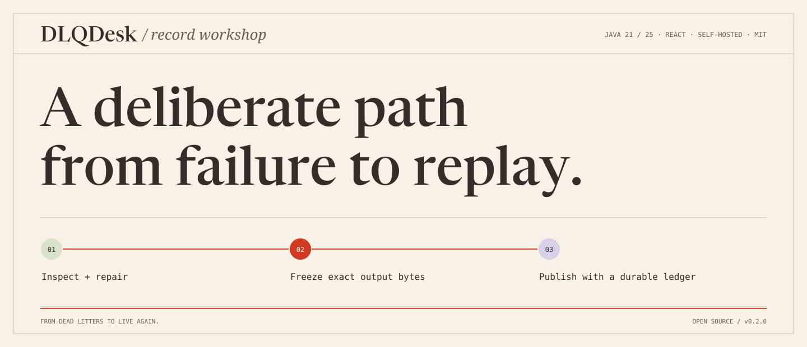
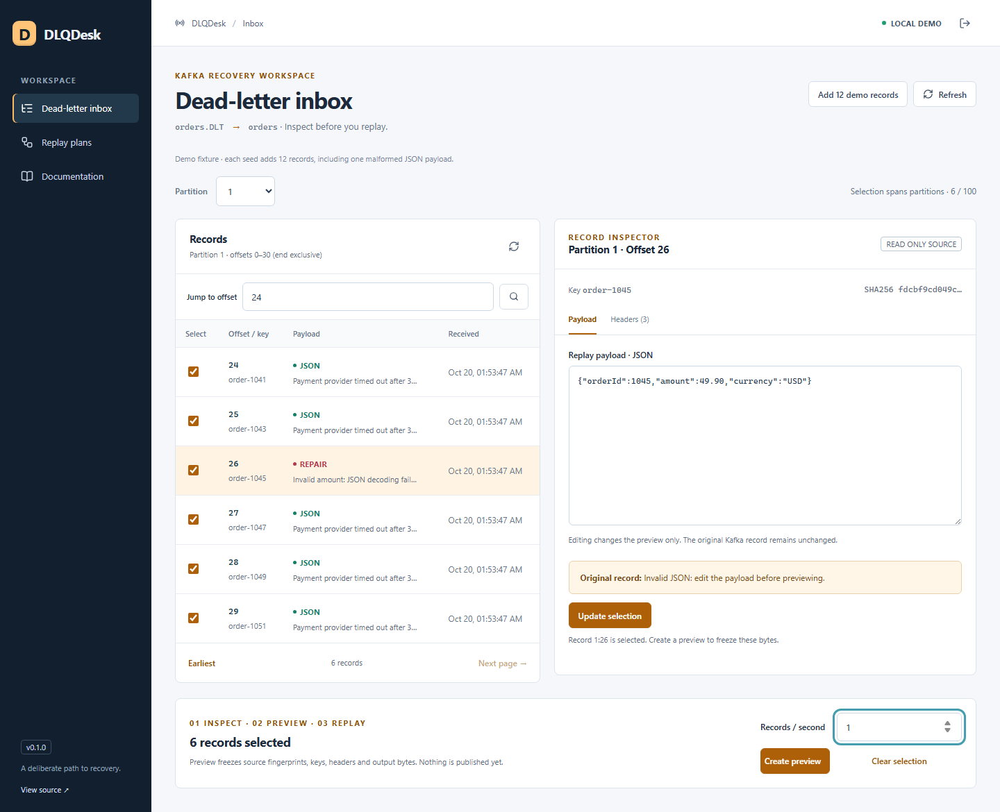

<p align="center"></p>

<p align="center">
<a href="https://github.com/lMysticl/dlqdesk/actions/workflows/ci.yml"></a>
<a href="LICENSE"></a>


</p>

**A deliberate recovery desk for Kafka dead letters.** Inspect a record, repair
its JSON, freeze a preview and replay at a controlled rate. A persistent ledger
shows what Kafka acknowledged and what still needs an operator's decision.

[Try the release](https://github.com/lMysticl/dlqdesk/releases/latest) ·
[Usage](docs/usage.md) · [Delivery semantics](docs/architecture.md) ·
[Validation](docs/validation.md) · [Engineering brief](docs/project-brief.md)



*The capture uses real records from the bundled synthetic-data demo, including
one malformed JSON payload. It is not a simulated inbox.*

## Try it locally

You need Java 21 or 25 and Docker. Clone the repository for the broker setup and
download `dlqdesk-0.1.0.jar` from the [release](https://github.com/lMysticl/dlqdesk/releases/tag/v0.1.0).

```sh
git clone https://github.com/lMysticl/dlqdesk.git
cd dlqdesk
docker compose up -d --wait
java -jar dlqdesk-0.1.0.jar --spring.profiles.active=demo --dlqdesk.bootstrap-servers=localhost:59092
```

Open **http://localhost:8092/**. Use **Use the bundled local demo token**, connect,
then choose **Add 12 demo records**. Inspect the two partitions, repair the
malformed JSON record, select records and create a preview. Review the frozen
plan before confirming **Start replay**. The ledger records actual destination
partition/offset acknowledgements.

The demo token is a public fixture. The demo endpoint exists only in the explicit
`demo` profile. Use synthetic data and stop the local broker with `docker compose down`
when finished. The application's H2 ledger remains in `./data/`.

## Why a separate recovery tool?

| Need | DLQDesk behavior |
|---|---|
| Inspect without advancing a production consumer | Manual partition assignment; no group ID or offset commits |
| Repair one malformed record | JSON editor; original record remains unchanged |
| Know exactly what will be published | Immutable preview with source/output SHA256 fingerprints |
| Control replay traffic | One worker, 1–100 records/s, at most 100 records per plan |
| Pause and continue | Settle an in-flight send, then resume pending entries |
| Understand a crash or lost acknowledgement | Confirmed SENT entries survive; uncertain entries become UNKNOWN and block resume |

**SENT means broker acknowledgement.** It does not mean downstream business
processing succeeded. Kafka and H2 do not share a transaction. If a process stops
after publishing but before saving the acknowledgement, the entry requires an
explicit review. DLQDesk does not promise exactly-once replay.

## Use your own topics

Configure `DLQDESK_API_TOKEN` with at least 32 characters,
`KAFKA_BOOTSTRAP_SERVERS`, `DLQDESK_DLT_TOPIC`, and `DLQDESK_TARGET_TOPIC`.
Run without the `demo` profile. The deployment has one source and one allowlisted
target; replay requests cannot choose arbitrary destinations.

Keys and headers are preserved byte-for-byte for supported records. The tool adds
`dlqdesk.run-id`, `dlqdesk.source`, and `dlqdesk.source-topic` headers for destination
inspection. Source offsets stay exact decimal strings throughout the API/UI.

See [security](SECURITY.md), [operating limits](docs/usage.md) and
[compatibility](docs/compatibility.md) before a real deployment.

## Build and verify

JDK 21 or 25, Node 24.15+ / 24.x and Docker for Kafka integration tests:

```sh
cd ui
npm ci
npm run check
npm test
npm run build
cd ..
./mvnw -B verify -Pintegration
```

On Windows, use `mvnw.cmd`. CI runs Java 21/25 on Ubuntu and Windows, with the
real Kafka contract on Ubuntu / Java 21. The [test map](docs/validation.md) covers
HTTP replay, binary header preservation, unchanged consumer offsets, rate limiting,
pause/resume, uncertain delivery and persistent recovery.

## Deliberate scope

v0.1.0 is a single-instance, self-hosted tool for small, reviewed JSON replays.
It is not a multi-cluster platform. It does not implement Schema Registry,
Avro/Protobuf, tombstone replay, multi-user RBAC or a retention policy for the
local ledger. Plan capacity and protect persisted payloads accordingly.

Built by [Pavel Putrenkov](https://github.com/lMysticl). Contributions and useful
reproductions are welcome. Original project code is [MIT licensed](LICENSE).
