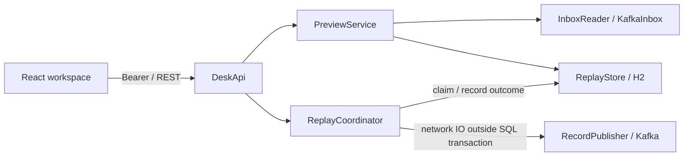
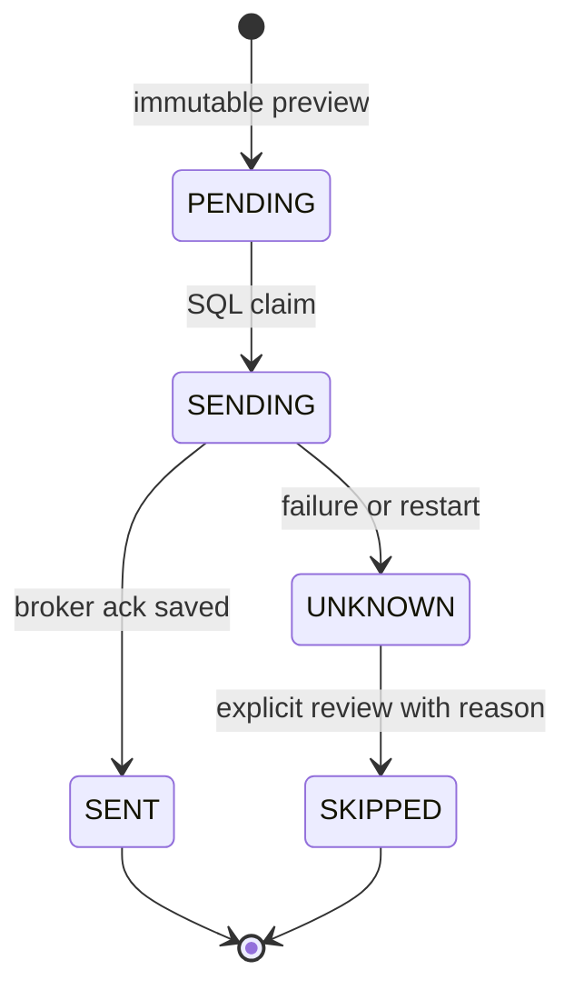

# Architecture and delivery semantics

`inbox` defines source records, exact coordinates and payload policy.
`kafka` adapts manually assigned consumers and one idempotent producer. Consumers
never subscribe to a group, commit offsets or automatically create source topics.
Kafka-specific classes stay outside preview/execution policy.

`replay` owns validation and a bounded single-worker coordinator. A preview loads
the selected sources, checks their fingerprints, validates JSON and freezes keys,
headers, output bytes, output hashes, target and rate. A start request cannot
replace these bytes or route to an arbitrary topic.

`persistence` stores previews, entry outcomes and audit events through JDBC and
short SQL transactions. Claiming changes PENDING to SENDING while holding the
run row lock. The worker then releases the SQL transaction before waiting for
Kafka. Recording an acknowledgement changes SENDING to SENT with destination
partition and offset. Flyway owns the schema.

There is no shared Kafka/H2 transaction. A publish can succeed before the SQL
acknowledgement is stored. The tool exposes that gap as UNKNOWN, blocks automatic
resume, and preserves the decision trail. Producer idempotence protects its own
retry sequence; it does not give application-level exactly-once delivery across
process restarts or separately created plans.

One semaphore admits an active run. The executor has one thread and one bounded
queue slot. A condition supports interruptible rate pacing and pause wakeups;
the loop rechecks time after spurious wakeups. Pause does not cancel a publish
whose delivery may already have occurred. Startup recovers RUNNING/PAUSE_REQUESTED
plans as INTERRUPTED and SENDING entries as UNKNOWN, keeping SENT entries intact.

The React inbox owns a transient selection and proposed JSON edits. The replay
view renders durable server state. Small list projections are polled serially;
full payloads are fetched only for an inspected record. Requests abort on
unmount/selection changes and stale results cannot overwrite a new selection.
Confirmation uses a native modal dialog with keyboard/focus behavior.

The application supports one instance, one source/target pair and small reviewed
JSON batches. It has no cluster coordinator, generic workflow engine or dynamic
adapter framework. See [usage](usage.md) for precise recovery and record limits.
